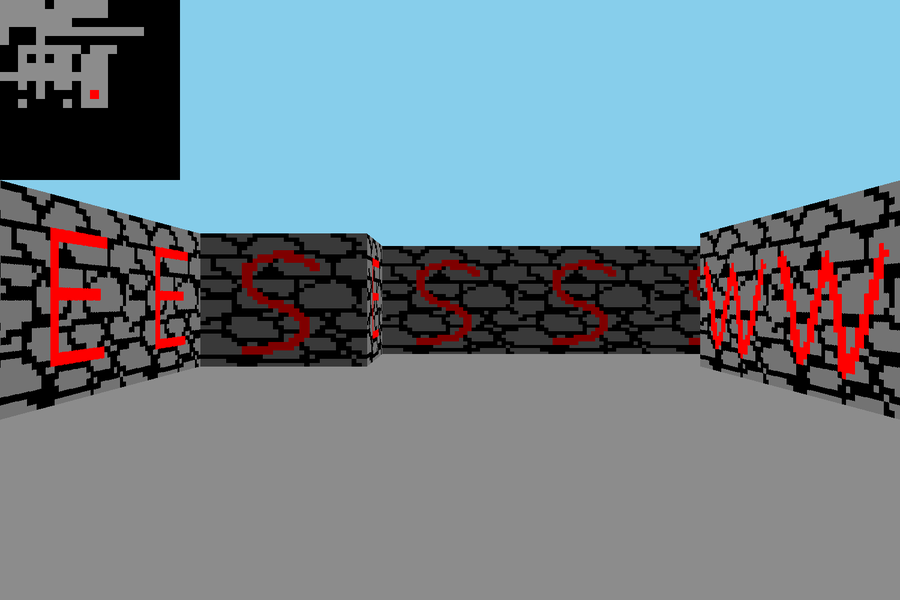
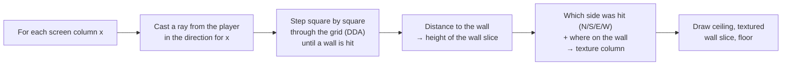

*This project has been created as part of the 42 curriculum by tfournie, mvachon.*

<h1 align="center">🧱 cub3D</h1>

<p align="center">
  <b>A Wolfenstein 3D-style raycasting engine, written from scratch in C.</b>
</p>

<p align="center">
  
  
  
  
</p>

<p align="center">
  
</p>

---

## 📖 About

**cub3D** renders a first-person 3D maze in real time from a simple 2D map, with the same technique as Wolfenstein 3D (1992): **raycasting**. There is no 3D library and no GPU work. Every pixel column on screen is computed by casting one ray through the map.

The program reads a `.cub` scene file, validates it, then lets you walk through the maze with textured walls, a minimap and smooth movement.

## ✨ Features

- 🎯 **Raycasting with the DDA algorithm**: one ray per screen column, exact wall distance with no fish-eye effect
- 🧱 **A different texture per wall direction** (north, south, east, west)
- 🎨 Floor and ceiling colors set in the map file
- 🧭 **Minimap** with the player's position
- 🏃 Movement with WASD, rotation with the arrow keys or the mouse, sprint with Shift
- ⏱️ **Game loop with an FPS limiter**, so the speed stays the same on every machine
- 📄 Strict `.cub` parser: it checks textures, colors and the map, and checks that the map is **closed** with a flood fill
- 🧹 **No memory leaks**: every allocation is checked and freed, including on errors, with clear error messages

## 🧠 How raycasting works



The distance is measured perpendicular to the camera plane, not from the player, which is what keeps the walls straight instead of curved.

## 🚀 Getting started

### Requirements
Linux with `cc`, `make` and the X11 development libraries:

```bash
sudo apt-get install libxext-dev libx11-dev libbsd-dev
```

### Build and run

```bash
git clone https://github.com/Tommfnr/Cub3D.git
cd Cub3D
make                       # MiniLibX is downloaded and built automatically
./cub3D maps/map.cub
```

## 🎮 Controls

| Key | Action |
|---|---|
| `W` `A` `S` `D` | Move forward / left / backward / right |
| `←` `→` | Turn the camera |
| Mouse | Turn the camera |
| `Shift` | Sprint |
| `Esc` or the window's close button | Quit |

## 🗺️ Map format (`.cub`)

```text
NO ./textures/Wall_bricks_N.xpm
SO ./textures/Wall_bricks_S.xpm
WE ./textures/Wall_bricks_W.xpm
EA ./textures/Wall_bricks_E.xpm

F 140,140,140
C 135,206,235

111111
100001
1000N1
111111
```

| Symbol | Meaning |
|---|---|
| `NO` `SO` `WE` `EA` | Texture for each wall direction (`.xpm`) |
| `F` / `C` | Floor / ceiling color (R,G,B, from 0 to 255) |
| `1` | Wall |
| `0` | Empty space |
| `N` `S` `E` `W` | Player start and the direction they face |

Any error, such as a missing texture, a bad color, an open map or several players, stops the program with an `Error` message that explains what is wrong.

## 🗂️ Project structure

```text
src/
├── main.c
├── parsing/       # .cub file checks: textures, colors, map
├── init/          # load the map, textures, colors and player direction
├── game/
│   ├── raycasting/   # DDA, wall distance, textured wall slices
│   ├── draw.c        # frame rendering
│   ├── minimap.c
│   ├── move_player.c / move_view.c
│   └── mouse_and_key.c
└── exit/          # error messages and freeing everything
libft/             # my own C standard library
maps/  textures/
```

## 👥 Team

| | Main contributions |
|---|---|
| **Tom Fournier** ([@Tommfnr](https://github.com/Tommfnr)) | Core raycasting and rendering, wall textures, game loop and FPS limiter, minimap, movement and controls, memory management and error handling |
| **Mathéo Vachon** ([@MathTheMith](https://github.com/MathTheMith)) | `.cub` parsing and map validation, floor and ceiling colors, wall slice drawing |

## 📚 Resources

- [Lode's raycasting tutorial](https://lodev.org/cgtutor/raycasting.html), the reference for DDA raycasting
- [MiniLibX documentation](https://harm-smits.github.io/42docs/libs/minilibx)
